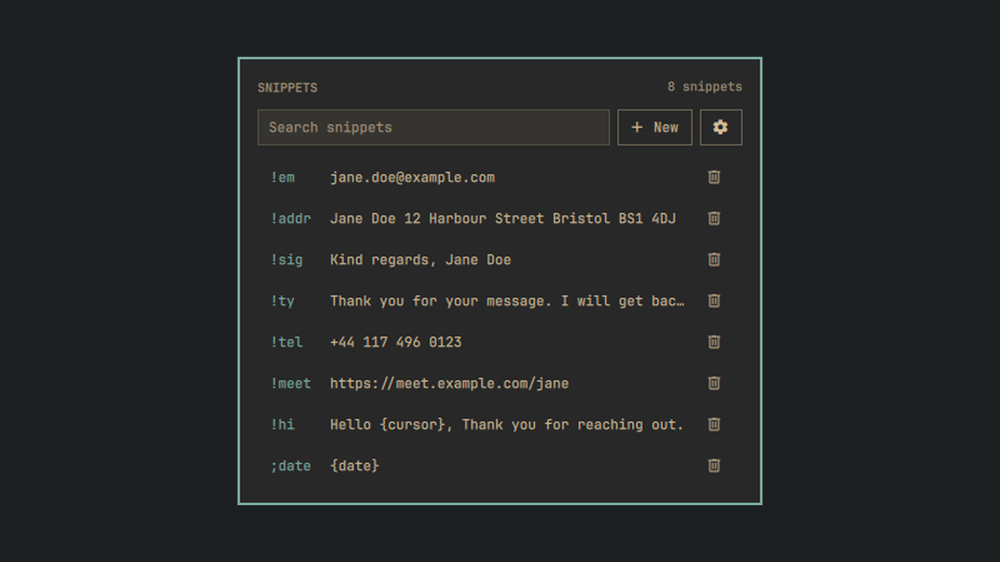
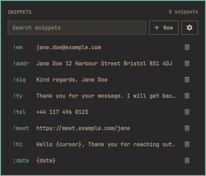
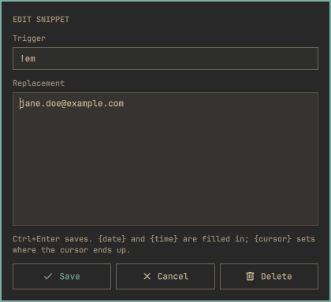
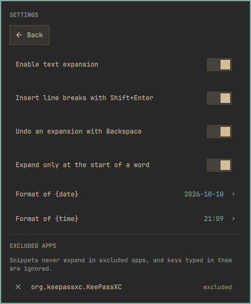

# Instant Snippets

Type a short trigger in any app and it is replaced with the text you saved for
it. `!em` becomes your email address, `!addr` your postal address, instantly
and wherever the cursor is.



It is an Omarchy shell plugin and nothing else: no daemon and no extra
package. Hyprland passes each key press to a small script the plugin loads
into Hyprland itself; no other program reads your keyboard.

## Install

```
omarchy plugin add https://github.com/MaNi4/omarchy-instant-snippets.git --enable
```

Open the panel from the bar, press **New**, enter a trigger and its
replacement, and save.

## Remove

```
omarchy plugin remove mani4.instant-snippets
```

Disabling or removing the plugin removes its hook from Hyprland as it is
unloaded. Your snippets stay in `~/.config/omarchy/extensions/instant-snippets.json`;
delete that file if you do not want to keep them.

## Features

- **Snippets**: a trigger of 2 to 32 characters and a replacement of up to
  1000 characters, on as many lines as it needs.
- **Search**: the field above the list searches triggers and replacements.
- **Case-sensitive triggers**: `!em` and `!EM` are different triggers, whether
  the capitals come from Shift or Caps Lock.
- **Undo**: Backspace as the first key within three seconds of an expansion
  removes the inserted text and restores the trigger. Can be turned off.
- **Line breaks with Shift+Enter**: on by default, so a multi-line snippet is
  not sent line by line in chat apps. Turn it off for multi-line shell
  commands, where a line break has to be Enter.
- **Excluded apps**: snippets never expand in the apps you exclude, and keys
  typed in them are ignored. Pick them from the running apps in the settings.
- **Placeholders**: `{date}` and `{time}` in a replacement are filled in when
  it is inserted, in the format chosen in the settings, and `{cursor}` marks
  where the cursor is left.
- **Word-start only**: on by default, a trigger expands only at the start of
  a word (after a space, Enter or Tab, or when you start typing), never in the
  middle of one. After you move the cursor or delete text, where it is no
  longer known what comes before, a trigger that begins with punctuation
  (`!em`) still expands and one that is itself a word (`adr`) waits for a
  space. Can be turned off.
- **Layouts**: triggers work on every keyboard layout that can type them, and
  follow layout switches. Digits and `+ - * / .` also count from the number pad.

## Screenshots

| Snippets | Editor | Settings |
|---|---|---|
|  |  |  |

## How it works

Hyprland already sees every key, because it is what delivers them to your
apps. Its Lua configuration can subscribe to key events
(`input.keyboard.key`), and that is the only place this plugin looks at keys:

1. The shell service works out which keys spell each trigger on your current
   layout, by asking `xkbcli`, which ships with the libxkbcommon Hyprland uses.
2. It writes those keys, as numbers, to a private file and has Hyprland load
   `engine.lua` with them through `hyprctl eval`.
3. The engine remembers the last few keys and, when they spell a trigger,
   reports "trigger number 3".
4. The shell checks that the session is not locked, then erases the trigger
   and types the replacement with `wtype`, which is part of Omarchy.

Nothing is added to your Hyprland configuration files. The engine is loaded at
run time, and again after Hyprland reloads its configuration or you switch
layout.

## Privacy

What the plugin does with your keys, plainly:

- **Hyprland hands every key press to the engine**, a Lua script running
  inside Hyprland. That is how a trigger is noticed. Nothing outside Hyprland
  reads the keyboard.
- **What the engine keeps**: the last keys typed, as key numbers, one more
  than your longest trigger has characters. It forgets them when the focus
  moves to another window, within about ten seconds of the last key, and
  when a shortcut is pressed. For the few seconds in which Backspace can
  undo an expansion it also keeps the keys that led to it, to put them back.
  It writes nothing to disk and logs nothing.
- **Where it does not listen at all**: in excluded apps, and while a launcher,
  menu or panel has the keyboard.
- **The lock screen**: Hyprland cannot tell the engine that the session is
  locked, so keys typed there pass through it like any others, are kept only
  as described above, and can at most produce "trigger N was typed". Before
  anything is typed, and again before each piece of a long replacement, the
  plugin asks Hyprland whether the session is locked, and types nothing if it
  is or if that cannot be told.
- **What leaves Hyprland**: "trigger N was typed", "undo" or "the focus
  moved", as an event any program of yours can see. It carries the trigger's
  number and nothing of the trigger itself, not even its length.
- **Process arguments** never contain a trigger, a replacement, or their
  lengths. The replacement and the backspaces that erase the trigger reach
  `wtype` on its standard input. The keys that spell your triggers go to
  Hyprland in a file only you can read, under `$XDG_RUNTIME_DIR`, which is
  gone at logout. Excluded apps are in it as numbers. For `{cursor}` the
  cursor is moved back by two fixed commands (ten steps, one step), and a
  line break typed as Shift+Enter is a fixed command too, so the number of
  such commands run, though not their arguments, follows the replacement.
- **What can show in a process list**: the keyboard layout, and which scripts
  your triggers use beyond plain ASCII (accented Latin, Cyrillic, ...): the
  whole block of characters is looked up, never the ones you chose.
- **Notifications** use fixed wording and never contain a trigger or
  replacement.
- With expansion disabled, or with no snippets, nothing is loaded into
  Hyprland.

## The snippets file

Snippets and settings are stored as plain text in
`~/.config/omarchy/extensions/instant-snippets.json`, readable by your user
only:

```json
{
  "enabled": true,
  "lineBreaksWithShiftEnter": true,
  "undoWithBackspace": true,
  "expandOnlyAtWordStart": true,
  "dateFormat": "yyyy-MM-dd",
  "timeFormat": "HH:mm",
  "excludedApps": ["org.keepassxc.KeePassXC"],
  "snippets": [
    { "trigger": "!em", "replacement": "me@example.com" }
  ]
}
```

The panel manages this file for you. Editing it by hand also works; changes
are picked up immediately, and the file is closed to other users whenever it
is read. If it contains an entry the plugin cannot use, the panel says so and
stops saving until the file is fixed, so that nothing in it is lost. Because
it is plain text, do not store passwords in it.

There can be up to 500 snippets.

## Limitations

- Start triggers with a character you rarely type before a letter, such as
  `!` or `;`. A trigger that is an ordinary word, or the beginning of one,
  expands as soon as it is typed at the start of a word: `adr` would expand
  in "adrenaline".
- Straight after an expansion the next trigger needs a space before it, as
  anywhere else in the middle of text.
- Backspace removes the last key from what the engine has seen, so a corrected
  typo still matches. Moving the cursor with the mouse is not seen.
- A trigger can only use characters your layout types with one key press, with
  or without Shift or AltGr. Characters that need a dead key or Compose cannot
  be part of a trigger. The panel marks triggers the current layout cannot type.
- A replacement can contain any printable characters, line breaks and tabs,
  whatever your layout: it is typed as text, not as keys.
- Replacements are typed, not pasted: a few hundred characters take a second
  or two, a thousand several. Each line break typed as Shift+Enter, and
  moving the cursor for `{cursor}`, adds half a second: the pause is what
  keeps the key from repeating in the window. Keys pressed meanwhile are
  ignored by the engine, and if the focus moves to another window the rest
  is not typed.
- A trigger that ends on a shifted character expands when Shift is released.
- An expansion that uses `{cursor}` cannot be undone with Backspace, nor can
  one with a tab in it, or with line breaks while Shift+Enter is turned off.
- Undo is withdrawn if you press a key or switch windows while the
  replacement is still being typed.
- Pasting into the panel reads no more of the clipboard than a replacement can
  hold.

## Opening the panel with a key

The panel has no shortcut of its own. This command toggles it, and can be
bound to any key in your Hyprland configuration:

```
omarchy-shell mani4.instant-snippets toggle
```

## Requirements

Omarchy with the Quickshell-based shell, and a Hyprland whose Lua
configuration has the `input.keyboard.key` event (0.56 has it).

It uses `wtype`, `wl-paste`, `xkbcli` and `notify-send`, all of which Omarchy
installs. There is nothing to set up.

## Tests

```
lua tests/engine.lua
node tests/run.js
```

The first drives the engine with a stand-in for Hyprland; the second checks
how triggers are turned into keys and that the Lua the shell writes starts the
engine. They need `lua` and `node`, and touch nothing outside a temporary
directory.

## License

MIT
